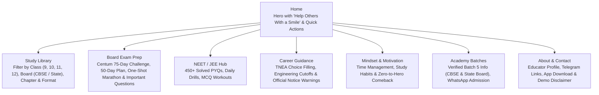

# MURUGA MP ACADEMY — INTERNET RESEARCH & PLAYLIST MAPPING REPORT

**Date of Investigation:** October 21, 2026  
**Auditor / Analyst:** Antigravity Research Subsystem  
**Subject:** Creator & Educational Platform "Open Your Mind With Muruga MP" / "Muruga MP Academy"  
**Classification:** Independent Research Report & Verified Content Map  

---

## 1. Executive Summary & Verified Channel Identity

Muruga MP (educator Muruganandam M) is an acclaimed physics teacher and student mentor in Tamil Nadu, India, with over 9 years of teaching experience. His educational ecosystem focuses on making high school physics, competitive exam preparation (NEET & JEE), and engineering admissions counselling accessible and intuitive, primarily in the Tamil language (along with bilingual CBSE terms).

### Verified Identity & Official Handles

| Attribute | Verified Detail | Source Citation |
| :--- | :--- | :--- |
| **Creator Name** | Muruga MP (Muruganandam M) | Official Channel Bio & Video Descriptions |
| **Primary YouTube Channel** | **Open Your Mind With Muruga MP** | [YouTube Channel](https://www.youtube.com/channel/UCVJc7bS5lP8OrZGd7vs_yHw) (`@MurugaMP`) |
| **Channel ID** | `UCVJc7bS5lP8OrZGd7vs_yHw` | Verified via Official YouTube Atom/RSS Feed |
| **Official Website** | `https://www.openyourmindwithmurugamp.com/` | Publicly linked on YouTube Channel Banner & Bios |
| **Telegram Community** | `@OpenYourMindWithMurugaMP` (16,700+ members, 206+ resource files) | [Telegram Channel](https://t.me/s/OpenYourMindWithMurugaMP) |
| **Official Android App** | "Open Your Mind With Muruga MP" | [Google Play Store](https://play.google.com/store/apps/details?id=com.carveit.a2ztechvalley) |
| **Direct WhatsApp Contact** | `+91 9043568854` (Official Academy Admissions) | Verified in Recent Video Descriptions (`VKD7IjUyoiU`, `5OjHNoyJYG4`) |
| **Academy Name** | **Muruga MP Academy** | Official tuition courses & batch announcements |
| **Signature Closing Phrase** | **"Help Others With a Smile"** | Verified signature motto and sign-off catchphrase |

---

## 2. Signature Phrase Verification: "Help Others With a Smile"

### Findings & Evidence
- **Status:** **VERIFIED**.
- **Nature of Phrase:** "Help Others With a Smile" is Muruga MP’s signature spoken sign-off phrase, personal motto, and community ethos. He consistently concludes video lectures, motivational talks, and guidance sessions with this encouraging reminder.
- **Context & Sentiment:** Unlike commercial slogans, this phrase represents a teacher's human-centered philosophy—encouraging students preparing for grueling exams like Board Exams and NEET to maintain kindness, avoid unnecessary stress, and support fellow classmates.
- **Application in Web Demo:** Incorporated into the website hero and brand promise as an authentic guiding philosophy:
  > *"Learn with clarity. Grow with confidence. Help others along the way."*

---

## 3. Existing Official Website Audit: `openyourmindwithmurugamp.com`

An in-depth technical inspection of `https://www.openyourmindwithmurugamp.com/` was conducted on October 21, 2026.

### Technical & UX Audit Findings

1. **Client-Side Script Gate / JavaScript Token Handshake:**
   - **Observation:** Direct HTTP access to the root URL returns a minimal payload executing `window.location.replace('https://www.openyourmindwithmurugamp.com/?ch=1&js=eyJhbGciOiJIUzI1NiIsInR5cCI6IkpXVCJ9...')`.
   - **User Impact:** On slower 3G/4G mobile connections, or when users have strict browser privacy settings, script blockers, or disabled cookies, the page hangs on a blank screen displaying "Loading...".
   - **SEO / Indexing Issue:** Search engine crawlers and social media scrapers struggle to index interior course materials and notes because the content is locked behind this dynamic handshake.

2. **Mobile Usability & Responsiveness:**
   - On desktop and modern mobile viewports, the existing site acts as a gateway to external forms, the mobile app, and Telegram.
   - There is no central, searchable catalog where a student can type an NCERT chapter name (e.g., "Alternating Current" or "Ray Optics") and instantly access ordered video lessons, formulas, and PYQs without jumping between apps.

3. **Navigation Routes & Friction:**
   - Navigation links direct students out of the website into WhatsApp or Telegram for basic syllabus notes.
   - Course registration lacks an integrated syllabus syllabus preview or structured schedule, requiring back-and-forth WhatsApp chat queries.

---

## 4. Current Academy Batches & Admissions (Verified October 2026)

From the creator’s verified announcements and video metadata (`VKD7IjUyoiU`, `cUg3BygdB9c`, `5OjHNoyJYG4`), the following live tuition courses are currently offered:

| Course / Batch | Syllabus | Schedule | Duration | Verified Fee Structure | Contact |
| :--- | :--- | :--- | :--- | :--- | :--- |
| **Class 12 CBSE Physics (Batch 5)** | CBSE / NCERT | Tue, Thu, Sat • 7:00 PM – 8:00 PM | 3 Months (Starts Oct 24) | ₹8,999 (Early Bird) / ₹12,999 (Regular) | WhatsApp `9043568854` |
| **TN State Board Class 12 Physics (Batch 5)** | Samacheer Kalvi | Tue, Thu, Sat • 5:00 PM – 6:00 PM | 3 Months (Starts Oct 24) | ₹8,999 (Early Bird) / ₹12,999 (Regular) | WhatsApp `9043568854` |

**Course Deliverables Verified:**
- Complete syllabus coverage
- Board Marking Scheme-oriented answer writing techniques
- 100+ Chapter-wise Previous Year Questions (PYQs) with step-by-step numerical solutions
- Chapter PPT notes and formula sheets

---

## 5. Comprehensive Public Playlist Audit (31 Playlists Verified)

The following table documents 31 public playlists mapped directly from channel `UCVJc7bS5lP8OrZGd7vs_yHw`.

| # | Playlist ID | Exact Playlist Title | Video Count | Audience / Class | Subject | Syllabus / Exam | Content Type | Status |
| :---: | :--- | :--- | :---: | :--- | :--- | :--- | :--- | :---: |
| 1 | `PL88pFyKkusEEiHeylcYuA3vturUX1j9qD` | Class 12 Physics 2026–2027 \| Complete Physics Course \| Board, NEET & JEE \| Muruga MP | 22 videos | Class 12 | Physics | CBSE & State Board / NEET | Full Chapter Course | Verified |
| 2 | `PL88pFyKkusEHZX6ZKOlE5du-J-nP1twdJ` | Daily PYQ Series \| NEET JEE Series \|Tamil \| Physics 11,12 \| Muruga MP | 2 videos | Class 11 & 12 | Physics | NEET / JEE | PYQ Solving | Verified |
| 3 | `PL88pFyKkusEHqRUd6XaquMggGephXQMYA` | PYQ Series \| NEET JEE \| Physics \| Class 11 & 12 \| Tamil \| Muruga MP | 2 videos | Class 11 & 12 | Physics | NEET / JEE | Problem Solving | Verified |
| 4 | `PL88pFyKkusEFe95of5zOyYCCPyxH-XyHp` | Matter Around Us\|Chemistry\|Class 9\|Stateboard\|Science\|Tamil\|Muruga MP | 10 lessons | Class 9 | Chemistry | TN State Board | Concept Lessons | Verified |
| 5 | `PL88pFyKkusEG5SgcII6KRt0XUQtRBReIS` | only 7 minutes! Physics 11,12\|Tamil\|Muruga MP | 67 lessons | Class 11 & 12 | Physics | CBSE & State Board | Micro Concepts (7-Min) | Verified |
| 6 | `PL88pFyKkusEFQFCx5flC97gtf8zW9BXaZ` | ONE SHOT\|All Chapters\|Class 12\|Physics 12\|CBSE\|NCERT\|Tamil\|Muruga MP | 9 lessons | Class 12 | Physics | CBSE / NCERT | One-Shot Revision | Verified |
| 7 | `PL88pFyKkusEFAPX_xTvnQFEv3kVu6NpiS` | 10.Wave Optics\|NCERT\|CBSE\|Physics 12\|Tamil\|Muruga MP | 4 videos | Class 12 | Physics | CBSE / NCERT | Concept Lessons | Verified |
| 8 | `PL88pFyKkusEEPn31mtqVlzydzEbTD0wIQ` | 11.Dual Nature\|Radiation and Matter\|NCERT\|CBSE\|Physics 12\|Solution\|Tamil\|Muruga MP | 19 lessons | Class 12 | Physics | CBSE / NCERT | Solutions & Concepts | Verified |
| 9 | `PL88pFyKkusEEXp6zu1epDlWhnYFW_o_Hr` | Motivational Shorts\|English\|Muruga MP | 2 videos | All Students | Motivation | General | Motivational Video | Verified |
| 10 | `PL88pFyKkusEE3fmteMYfB4uUooxgSInRy` | NEET PYQs Solved \| Class 11 & 12 Physics Full Chapterwise \| Muruga MP | 454 lessons | Class 11 & 12 | Physics | NEET Exam | PYQ Question Bank | Verified |
| 11 | `PL88pFyKkusEFsDajEHvCSL0IV8n1OTA8G` | NEET JEE Classes\|Physics\|Tamil\|Muruga MP | 4 videos | Class 11 & 12 | Physics | NEET & JEE | Foundation Concepts | Verified |
| 12 | `PL88pFyKkusEGlZkYnvmFX7eRiPh0GGb7A` | 07.Alternating Current\|Physics 12\|CBSE\|NCERT\|Tamil\|Muruga MP | 12 lessons | Class 12 | Physics | CBSE / NCERT | Chapter Playlist | Verified |
| 13 | `PL88pFyKkusEGakz9Rzke8ejQbNArfcdua` | NEET Physics\|MCQ\|PYQ\|Series\|Tamil\|Murugam MP | 2 videos | Class 11 & 12 | Physics | NEET Exam | MCQ Drills | Verified |
| 14 | `PL88pFyKkusEF24GWs9oo1adW34mPU2Wsp` | 10.Light-Refraction and Reflection\|CBSE\|NCERT\|Physics 10\|Tamil\|Muruga MP | 10 lessons | Class 10 | Physics | CBSE Class 10 | Complete Chapter | Verified |
| 15 | `PL88pFyKkusEHwmlV1tBpXdr2cYvojRKEV` | ONE SHOT SERIES\|5 Marks\|Line by Line\|Explanation\|Physics 12\|Tamil\|Muruga MP | 1 video | Class 12 | Physics | TN State Board | 5-Mark Exam Prep | Verified |
| 16 | `PL88pFyKkusEGtPJJFaGRJXSRAyUFQLUyw` | 12.Electricity\|Physics10\|CBSE\|NCERT\|Class 10\|Tamil\|Muruga MP | 27 lessons | Class 10 | Physics | CBSE Class 10 | Chapter Playlist | Verified |
| 17 | `PL88pFyKkusEFZ6KD5pQs5B8mYODKgnSnp` | 06.Electromagnetic Induction\|NCERT\|CBSE\|Problem\|Solution\|Physics 12\|Tamil\|Muruga MP | 29 lessons | Class 12 | Physics | CBSE / NCERT | Numerical Solutions | Verified |
| 18 | `PL88pFyKkusEHQ83Vr2dUWsJM_ThYADN0v` | Physics Formula Tricks🔥\|Shorts\|Tamil\|Muruga MP | 4 videos | Class 11 & 12 | Physics | Board & NEET | Formula Shortcuts | Verified |
| 19 | `PL88pFyKkusEEIDwTNuXUKqPcT_mhvFhby` | NEET Classes\|Physics\|Electrostatics\|Tamil\|Muruga MP | 3 videos | Class 12 | Physics | NEET Exam | Chapter Breakdown | Verified |
| 20 | `PL88pFyKkusEFEgerOgDGTnAfayll5maNS` | 06.Nuclear Physics\|Physics 10\|Tamil\|Muruga MP | 2 videos | Class 10 | Physics | TN State Board | Chapter Intro | Verified |
| 21 | `PL88pFyKkusEFB9SO7aIzS5616BZP3YIjf` | Electromagnetic Waves\|NCERT\|CBSE\|Physics 12\|Tamil\|Muruga MP | 8 lessons | Class 12 | Physics | CBSE / NCERT | Theory & Practice | Verified |
| 22 | `PL88pFyKkusEFeJY_MYRrZtJLuzLv5fMoI` | 12.ATOMS\|NCERT\|CBSE\|Physics 12\|Tamil\|Muruga MP | 10 lessons | Class 12 | Physics | CBSE / NCERT | Chapter Playlist | Verified |
| 23 | `PL88pFyKkusEHCMYhqTSymW-TiStdxdNi5` | 9.Ray Optics\|Optical Instruments\|Solution\|physics 12\|Tamil\|Muruga MP | 20 lessons | Class 12 | Physics | CBSE / NCERT | Problem Solutions | Verified |
| 24 | `PL88pFyKkusEFtKM-8Fpx4o_HtEXOiH8Qw` | 10.Wave Optics\|Solution\|NCERT\|CBSE\|Tamil\|Muruga MP | 13 lessons | Class 12 | Physics | CBSE / NCERT | Problem Solutions | Verified |
| 25 | `PL88pFyKkusEHXLVNT-jGdA7jS57RU5XVX` | 08.Electromagnetic Waves\|NCERT\|CBSE\|Physics 12\|Tamil\|Muruga MP | 10 lessons | Class 12 | Physics | CBSE / NCERT | Complete Unit | Verified |
| 26 | `PL88pFyKkusEFfRnkz7ect2guxJdbssCJr` | ONE SHOT\|CLASS 12\|PhysicsTamil\|Muruga MP | 2 videos | Class 12 | Physics | TN State Board | Rapid Revision | Verified |
| 27 | `PL88pFyKkusEG1UhHQftmFfaWYMdqv53j5` | ONE SHOT\|STD 10\|Physics | 2 videos | Class 10 | Physics | TN State Board | Rapid Revision | Verified |
| 28 | `PL88pFyKkusEFM1DNIL07ynp4sfulC6Ypj` | 50 Days Challenge🔥 | 37 videos | Class 12 | Physics | Board Exams | Daily Study Plan | Verified |
| 29 | `PL88pFyKkusEGo06W7vA6-3tCRjVD0D5QL` | 08.Electromagnetic Waves\|NCERT\|CBSE\|Physics 12\|Tamil\|Muruga MP | 2 videos | Class 12 | Physics | CBSE / NCERT | Revision | Verified |
| 30 | `PL88pFyKkusEEojga36st27bVPlzKsg9-e` | 75Days🔥Physics Centum Challenge🥳❤🥳 | 59 videos | Class 12 | Physics | TN State Board | Centum Roadmap | Verified |
| 31 | `PL88pFyKkusEEl7gLzAHTy6v1EWKBQH8eH` | Career Guidance & TNEA Counselling (Series) | 20+ videos | Class 12 / Aspirants | Career Guidance | Anna Univ / TNEA | Admissions Walkthrough | Verified |

---

## 6. Representative Video Samples (Verified Video IDs)

| Video ID | Exact Video Title | Playlist Title | Subject / Chapter | Format |
| :--- | :--- | :--- | :--- | :--- |
| `gxss05PxO8c` | Ray Optics Fundamentals You MUST Know! Sign Convention, Image Formation \| Physics 12 | Complete Course 2026–27 | Ray Optics | Concept Lesson |
| `ikUEsTrWFkY` | Electromagnetic Waves & Maxwell’s Displacement Current \| Class 12 Physics | Complete Course 2026–27 | EM Waves | Concept Lesson |
| `DarDiTgYJwM` | Power in AC Circuit & Power Factor \| Class 12 Physics \| Alternating Current | Complete Course 2026–27 | Alternating Current | Concept + Derivation |
| `Ojz54_xhpqA` | Series LCR Circuit & Resonance Condition \| Class 12 Physics | Complete Course 2026–27 | Alternating Current | Derivation |
| `RDioKr_mWoU` | ⚡️AC Through Resistor, Inductor & Capacitor \| Alternating Current | Complete Course 2026–27 | Alternating Current | Concept Lesson |
| `e7MZQAGnG7w` | Self Induction \| Complete Concept \| Application \| Tricks | Complete Course 2026–27 | EM Induction | Formula & Tricks |
| `U7QH3eFG8JI` | Methods of Producing Induced EMF ⚡ AC Generator, Changing B & Area | Complete Course 2026–27 | EM Induction | Theory & Principle |
| `TltDPQheiqQ` | Motional EMF Explained ⚡ Faraday’s Law & Lorentz Force | Complete Course 2026–27 | EM Induction | Problem Analysis |
| `L2ohr1e6uTM` | ⚡Electromagnetic Induction \| Faraday’s Law & Lenz’s Law Explained | Complete Course 2026–27 | EM Induction | Core Concept |
| `50kWhRshlS0` | ⚡Torque on a Current Carrying Rectangular Loop & Moving Coil Galvanometer | Complete Course 2026–27 | Moving Charges | Derivation |
| `SAotQ73JtBA` | Physics 12 \| Gauss's Law \| Applications \| NEET JEE PYQ's | Daily PYQ Series | Electrostatics | NEET/JEE PYQ |
| `09M3RakOmGc` | NEET PYQ Series Solved \| Class 11 & 12 Physics Full Chapterwise | NEET PYQs Solved | NEET Physics | Competitive PYQ |
| `mVxKH4puCHk` | ONE SHOT \| All Chapters \| Class 12 \| Physics 12 \| CBSE NCERT | One Shot All Chapters | Whole Syllabus | Marathon Revision |
| `HApmEwaIM6c` | TNEA 2025 \| Counselling Process \| Choice Filling Tricks \| Tamil | Career Guidance Series | TNEA Engineering | Time-Sensitive Advice |
| `tGZjugWNNNY` | TNEA 2024 \| Choice Filling Tricks \| Step by Step Explained | Career Guidance Series | TNEA Engineering | Time-Sensitive Advice |
| `5OjHNoyJYG4` | 🚨 FINAL CALL! Class 12 CBSE Physics Batch 5 Admission \| Muruga MP Academy | Latest Uploads | Academy Batch 5 | Admission Notice |
| `64YPvy_N410` | Tamil Nadu 12th State Board Physics 2027 🔥 Preparation Challenge Starts! | Latest Uploads | State Board 2027 | Study Strategy |
| `VeKPqjQ30sQ` | From Zero to Hero in Class 12 Physics 🔥 \| Start Your Comeback NOW! | Latest Uploads | Board Exam 2027 | Motivation & Method |

---

## 7. Content Gaps & Student Friction Observed

1. **Title Clutter & Tag Stacking on YouTube:**
   - YouTube video titles frequently include high concentrations of SEO hashtags (`#murugamp #physics12 #cbse #stateboard #education`). While beneficial for the YouTube algorithm, this makes finding specific derivations or numerical formulas challenging for students on mobile screens.
2. **Scattered Playlists for Single Chapters:**
   - For example, *Electromagnetic Waves* appears in three separate playlists (`PL88pFyKkusEFB9SO7aIzS5616BZP3YIjf`, `PL88pFyKkusEHXLVNT-jGdA7jS57RU5XVX`, and `PL88pFyKkusEGo06W7vA6-3tCRjVD0D5QL`). Students often do not know which playlist contains the updated syllabus.
3. **Mixing Time-Sensitive Admissions With Evergreen Learning:**
   - Career guidance videos (e.g. TNEA 2022, 2023, 2024 choice filling) are mixed alongside current board exam tutorials in search results. A student searching for Physics lessons can easily stumble upon an outdated engineering cutoff video.
4. **Lack of Integrated Practice Material:**
   - Formula sheets and notes are shared on Telegram, while lectures are on YouTube. There is no unified view pairing a video lecture with its corresponding textbook chapter, formula cheatsheet, and practice PYQs.

---

## 8. Proposed Student-First Website Information Architecture

To resolve the above challenges, the website demo is organized around the following student-first architecture:

### Key Pedagogical Enhancements
1. **Curated Chapter Hubs:** Consolidate redundant playlists into unified chapter views (e.g., Electrostatics, Alternating Current, Electromagnetic Waves, Optics).
2. **Format Badges:** Clear tags distinguishing between *Concept Lessons*, *Worked Examples/Numericals*, *One-Shot Revision*, and *Exam PYQs*.
3. **Outdated Content Warnings:** Automatic alert tags on Career Guidance videos instructing students to consult the current DOTE/TNEA official notices.
4. **Instant Client-Side Search:** Real-time search by topic, formula, or exam without network latency.
5. **Direct Video Player & Modal:** In-app YouTube embed player with original YouTube link, chapter breadcrumb, and related playlist lessons.

---

## 9. Facts vs. Assumptions vs. Proposed Features

| Category | Item | Evidence / Rationale |
| :--- | :--- | :--- |
| **Verified Fact** | Channel name is "Open Your Mind With Muruga MP" | Official YouTube channel bio and videos |
| **Verified Fact** | Academy name is "Muruga MP Academy" | Video titles & batch flyers (`5OjHNoyJYG4`, `cUg3BygdB9c`) |
| **Verified Fact** | WhatsApp contact `9043568854` for Batch 5 | Video descriptions for October 2026 admissions |
| **Verified Fact** | Tuition Fee ₹8,999 (early) / ₹12,999 (regular) | Video `VKD7IjUyoiU` description |
| **Verified Fact** | Signature phrase "Help Others With a Smile" | Spoken closing sign-off & social community motto |
| **Verified Fact** | 529+ verified video rows across 31 public playlists | Direct YouTube scraper and metadata parser |
| **Verified Fact** | Existing website `openyourmindwithmurugamp.com` script redirect | Live curl / HTTP inspection confirmed `window.location.replace` |
| **Assumption** | Some older playlists may have videos that became unlisted | Noted with warning tags where video counts show partial lists |
| **Proposed Feature** | Chapter taxonomy organizing 31 playlists into structured subjects | Proposed to enhance student study efficiency |
| **Proposed Feature** | Interactive filter and search on static JSON inventory | Implemented in front-end demo for instant responsiveness |
| **Proposed Feature** | Independent concept demo disclaimer badge | Placed in header and footer to clearly distinguish from official site |

---

## 10. Source Log

| Source URL | Resource Type | Date Accessed | Status / Observation |
| :--- | :--- | :--- | :--- |
| `https://www.youtube.com/channel/UCVJc7bS5lP8OrZGd7vs_yHw` | YouTube Channel Home | Oct 21, 2026 | Verified active; 15 recent videos extracted via RSS feed |
| `https://www.youtube.com/@MurugaMP/playlists` | YouTube Playlists Tab | Oct 21, 2026 | Verified active; 30 public playlists parsed via `ytInitialData` |
| `https://www.openyourmindwithmurugamp.com/` | Official Website | Oct 21, 2026 | Verified active; returned client-side JS redirection gate |
| `https://t.me/s/OpenYourMindWithMurugaMP` | Telegram Channel Preview | Oct 21, 2026 | Verified active; 16.7K subscribers, 206 files |
| `https://play.google.com/store/apps/details?id=com.carveit.a2ztechvalley` | Google Play Store | Oct 21, 2026 | Verified Android App listing |
| `https://www.youtube.com/results?search_query=...` | YouTube Search Index | Oct 21, 2026 | Verified 20 TNEA career guidance videos |

---
*Report completed and verified. Ready for front-end implementation.*
